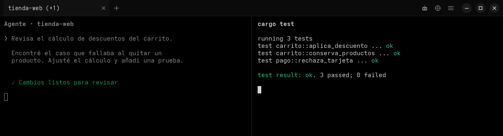
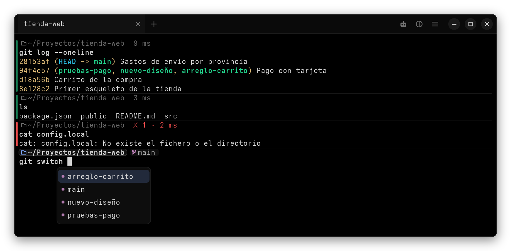

<p align="center">
  
</p>

<p align="center">
  <strong>Terminal para Linux acelerada por GPU, con bloques de comandos, completado inteligente
  y seguimiento de agentes de código.</strong><br>
  Escrita en Rust. Ligera, rápida y en español.
</p>

<p align="center">
  <a href="https://github.com/garbanhh/garbo/releases/latest"></a>
  <a href="LICENSE"></a>
  
  
</p>

<p align="center">
  <a href="#instalación">Instalación</a> ·
  <a href="#características">Características</a> ·
  <a href="#atajos-de-teclado">Atajos</a> ·
  <a href="#configuración">Configuración</a> ·
  <a href="#compilar-desde-el-código">Compilar</a>
</p>

<p align="center">
  
</p>

## Características

- **Rápida y ligera.** Dibuja con la GPU (wgpu: Vulkan u OpenGL) y solo cuando algo cambia: en
  reposo no gasta CPU y arranca con unos 30 MB de memoria.
- **Bloques de comandos.** Cada comando y su salida forman un bloque con la carpeta, la duración y
  el resultado (en rojo si falla). Se seleccionan, se recorren con el teclado y se copian enteros o
  solo su salida.
- **Completado al estilo Warp.** `Tab` abre un menú con lo que puede ir en cada sitio: órdenes,
  carpetas tras `cd`, ramas de git, scripts de `package.json`, objetivos de `make`, equipos de SSH…
  Mientras escribes, sugiere en gris comandos que ya usaste en esa carpeta.
- **Edición cómoda de la línea.** `Shift+Intro` para escribir un comando en varias líneas, borrar
  palabras con `Ctrl+Retroceso`, deshacer con `Ctrl+Z` y colocar el cursor con un clic.
- **Hecha para agentes de código.** El panel muestra el estado de Claude Code, Codex, Gemini CLI,
  Aider y otros, con un árbol de subagentes para las sesiones compatibles. Cuando un agente
  termina y no estás viendo su sesión, aparece un aviso del escritorio que permite volver a su
  pestaña. Las capturas de pantalla se pegan como imagen.
- **Pestañas y paneles divididos.** Las pestañas van en la barra de título y se titulan solas con
  lo que se está haciendo; cada una se puede dividir en paneles (un agente a la izquierda y las
  pruebas a la derecha, sin tmux).
- **A tu gusto.** Temas, fuentes, atajos y un panel de ajustes que aplica cada cambio al momento y
  lo guarda en `config.toml`.
- **Enlaces y rutas con Ctrl+clic.** Abre URL y lleva los errores de compilación
  (`src/main.rs:42:5`) a tu editor, en esa línea.
- **Búsqueda en el historial.** `Ctrl+Shift+F` resalta todas las coincidencias y, con un bloque
  seleccionado, busca solo en él.
- **Texto impecable.** Emoji a color (también COLRv1), CJK, *true color*, estilos de subrayado y
  caracteres de cajas dibujados al píxel.
- **Actualizaciones.** Avisa de las versiones nuevas y permite instalarlas desde Garbo cuando el
  paquete (RPM o `.deb`) está firmado.

## Instalación

Descarga el paquete de la [última versión](https://github.com/garbanhh/garbo/releases/latest) para
tu sistema e instálalo:

```bash
# Fedora y derivadas (.rpm)
sudo dnf install ./garbo-*.x86_64.rpm

# Debian 12 o posterior, Ubuntu 22.04 o posterior y derivadas (.deb)
sudo apt install ./garbo_*_amd64.deb
```

Garbo aparece en el menú de aplicaciones. La aplicación avisa cuando hay una versión nueva y la
instala con el gestor de paquetes del sistema, tras comprobar la suma SHA-256 y la firma.

**Requisitos:** Linux con Wayland o X11 (desarrollada y probada en Fedora 45 con GNOME) y una GPU
con Vulkan u OpenGL. Los bloques de comandos, las sugerencias y el completado funcionan con bash,
zsh y fish.

## Uso

### Atajos de teclado

**Pestañas y ventana**

| Atajo | Acción |
|---|---|
| `Ctrl+Shift+T` / `Ctrl+Shift+W` | Abrir pestaña / cerrar el panel (o la pestaña) |
| `Ctrl+Tab`, `Ctrl+AvPág` / `Ctrl+Shift+Tab`, `Ctrl+RePág` | Pestaña siguiente / anterior |
| `Ctrl+Shift+RePág` / `Ctrl+Shift+AvPág` | Mover la pestaña |
| `Alt+1` … `Alt+9` | Ir a una pestaña (`Alt+9`: la última) |
| `Ctrl+Shift+P` | Paleta de comandos |
| `Ctrl+,` | Ajustes |
| `Ctrl+Shift+D` / `Ctrl+Shift+Alt+D` | Dividir: panel a la derecha / debajo |
| `Alt+←` `→` `↑` `↓` | Cambiar de panel (si la pestaña está dividida) |
| `Ctrl+Shift+A` / `Ctrl+Shift+E` | Panel de agentes / de puertos |

**Línea de órdenes**

| Atajo | Acción |
|---|---|
| `Tab` / `Ctrl+Espacio` | Menú de completado (sin candidatos, `Tab` llega al shell) |
| `→` o `Ctrl+F` / `Ctrl+→` | Aceptar la sugerencia en gris / solo su siguiente palabra |
| `Shift+Intro` | Nueva línea sin ejecutar (también en Claude Code y otros agentes) |
| `Ctrl+Retroceso` / `Ctrl+Supr` | Borrar la palabra anterior / siguiente |
| `Ctrl+Z` | Deshacer |
| Clic en lo escrito | Llevar el cursor ahí |
| `↑` / `↓` | En un comando de varias líneas, cambiar de línea |

**Texto, bloques e historial**

| Atajo | Acción |
|---|---|
| `Ctrl+Shift+F` | Buscar en el historial (con un bloque seleccionado, solo en él) |
| `Ctrl+Shift+C` / `Ctrl+Shift+V` | Copiar / pegar (también imágenes) |
| `Ctrl+Shift+↑` / `Ctrl+Shift+↓` | Bloque de comandos anterior / siguiente |
| `Ctrl+Shift+O` | Copiar la salida del bloque seleccionado o del último comando |
| `Shift+RePág` / `Shift+AvPág` / `Shift+Inicio` / `Shift+Fin` | Recorrer el historial |
| `Ctrl+Shift+K` | Limpiar el historial |
| `Ctrl++` / `Ctrl+-` / `Ctrl+0` | Aumentar / reducir / restablecer la fuente |
| `Ctrl+Shift+Y` | Siguiente tema |
| `Ctrl+Shift+R` | Recargar la configuración |

Todos los atajos de Garbo se cambian en la sección `[keybindings]` de la configuración.

### Ratón

- Doble clic selecciona una palabra; triple clic, una línea; `Ctrl+Alt` y arrastrar, un rectángulo.
- `Ctrl`+clic abre lo que hay bajo el ratón: una URL en el navegador, o una ruta como
  `src/main.rs:42:5` en tu editor (`$EDITOR`) en esa línea; los editores de terminal, como nano o
  vim, se abren en una pestaña nueva. Con `Ctrl` pulsado, lo que se puede abrir se subraya.
- El clic central pega la selección primaria; sobre una pestaña, la cierra.
- `Shift` fuerza la selección local en programas que capturan el ratón.
- Arrastrar un archivo a la ventana escribe su ruta.
- La barra de pestañas mueve la ventana y con doble clic la maximiza; los bordes la redimensionan.

### Completado y sugerencias

**Menú de completado.** `Tab` muestra lo que puede ir en la palabra que se está escribiendo: órdenes
en la primera palabra, solo carpetas tras `cd`, ramas tras `git checkout`/`switch`/`merge`,
subórdenes de `git`, `cargo`, `npm`, `dnf` o `systemctl` con su descripción, scripts de
`package.json`, objetivos de `make`, equipos de `~/.ssh/config` y archivos en el resto. La búsqueda
no distingue mayúsculas ni tildes (`doc` encuentra `Documentos`, `videos` encuentra `Vídeos`) y, si
nada empieza igual ni lo contiene, busca las letras en orden. `↑` `↓` (o `Tab`/`Shift+Tab`) eligen,
`Intro`, `→` o un clic aceptan y `Esc` cierra; seguir escribiendo refina la lista. Con un único
candidato se escribe directamente; si no hay ninguno (por ejemplo, opciones `-x`), `Tab` llega al
shell y funciona su autocompletado de siempre.



**Sugerencia en gris.** A partir de dos caracteres, Garbo muestra en gris el resto de un comando ya
usado que empieza igual: primero lo ejecutado en la carpeta actual y, si no, lo más reciente. Si el
historial no tiene nada, sugiere el único candidato del completado (`cd Doc` → `umentos/`).

Garbo guarda su propio historial en `~/.local/share/garbo/history.tsv`, con la carpeta de cada
comando, y lo combina con el del shell (`~/.bash_history`, `~/.zsh_history` o el de fish). Un `cd`
a una ruta relativa solo se sugiere en la carpeta donde se hizo, y solo se sugieren comandos que se
pueden ejecutar (programas del `PATH`, órdenes internas del shell, alias y funciones de sus
archivos de arranque). Los comandos que empiezan por un espacio no se guardan. En fish, mientras
la sugerencia de Garbo esté activada, se apaga la sugerencia propia de fish en sus pestañas, porque
ocuparían el mismo sitio.

En *Ajustes → Completado* se puede desactivar la sugerencia en gris, hacer que `Tab` la acepte (el
menú pasa a `Ctrl+Espacio`) y abrir el menú automáticamente mientras se escribe.

### Edición de la línea

Garbo añade al shell los atajos de edición de Warp. `Shift+Intro` parte el comando en varias líneas
sin ejecutarlo; al pulsar `Intro` se ejecutan todas, una tras otra. En un comando de varias líneas,
`↑` y `↓` cambian de línea; en la primera y en la última recorren el historial como siempre. Un
clic en lo escrito lleva el cursor a ese punto. `Ctrl+Retroceso` y `Ctrl+Supr` borran por palabras
tal como las entiende cada shell, sin cambiar su configuración (en bash y fish, de
`~/Documentos/Proyectos` solo se va `Proyectos`; zsh sigue su `WORDCHARS`), y `Ctrl+Z` deshace.

Con un agente en primer plano, `Shift+Intro` también inserta un salto de línea (en Claude Code,
Codex o Gemini CLI se envía `Ctrl+J`) y `Ctrl+Retroceso` borra la palabra anterior. En el resto de
programas (vim, python…) las teclas funcionan como siempre.

### Paneles divididos

`Ctrl+Shift+D` divide el panel actual y abre otro a la derecha; `Ctrl+Shift+Alt+D`, debajo. El
nuevo empieza en la misma carpeta. Un clic o `Alt`+flecha cambian de panel, las líneas que los
separan se arrastran para repartir el espacio y `Ctrl+Shift+W` (o `exit`) cierra el panel. La
pestaña muestra cuántos paneles tiene ("(+2)") y avisa del más urgente: si un agente te necesita
en cualquiera de ellos, lo verás en la barra.

### Buscar

`Ctrl+Shift+F` abre una barra de búsqueda arriba a la derecha. Busca el texto tal cual, sin
distinguir mayúsculas salvo que escribas alguna, y resalta todas las coincidencias; la actual
destaca en amarillo y el contador dice cuál es ("3/17"). `Intro` o `↑` van a la anterior,
`Shift+Intro` o `↓` a la siguiente y `Esc` cierra. Si hay un bloque seleccionado, busca solo
dentro de él (la etiqueta *Bloque* quita o pone el límite): útil para revisar un registro largo o
los errores de una compilación.

### Bloques de comandos

Cada comando y su salida forman un bloque. Una barra en el margen izquierdo indica su estado
(verde: correcto; rojo: error; azul: en ejecución).

Con el **prompt de Garbo** (activado por defecto), cada bloque muestra encima del comando la carpeta
en la que se ejecutó y su duración (o el código de error, en rojo), y el comando en negrita. El
prompt actual es una etiqueta con la carpeta y, en un repositorio, la rama de git; lo que se
escribe va debajo, desde la primera columna. Se desactiva en *Ajustes → Bloques → Prompt de Garbo*
para usar el prompt propio del shell.

Un bloque se selecciona con `Ctrl+Shift+↑` / `Ctrl+Shift+↓` o con un clic en el margen izquierdo.
Con un bloque seleccionado, `Ctrl+Shift+C` copia el bloque completo y `Ctrl+Shift+O` su salida; la
paleta de comandos permite además copiar solo el comando.

La integración funciona con bash, zsh y fish sin tocar su configuración. Garbo inicia bash con
`--rcfile` apuntando a [`shell/garbo.bash`](shell/garbo.bash), que carga `~/.bashrc`; zsh, con un
`ZDOTDIR` propio ([`shell/zsh/.zshenv`](shell/zsh/.zshenv)) que lo devuelve a su valor y carga los
archivos de siempre antes de [`shell/garbo.zsh`](shell/garbo.zsh); y fish, con `--init-command`,
que carga [`shell/garbo.fish`](shell/garbo.fish) después de `config.fish`. Los tres marcan con
OSC 133 el prompt, el comando y su salida (fish 4 ya lo hace por sí mismo), y también el prompt
derecho de zsh y fish, para que no se tome por parte del comando. Cada bloque queda anclado al propio texto de la rejilla, así que
conserva su sitio al desplazarse, al recortarse el historial y al redimensionar. Se desactiva con
`shell_integration = false`, o solo su aspecto con `blocks = false`.

### Agentes de código

Los botones de la barra de pestañas (o `Ctrl+Shift+A` y `Ctrl+Shift+E`) abren un panel lateral:

- **Agentes**: pestañas con un agente de código (Claude Code, Codex, Gemini CLI, Aider, OpenCode,
  entre otros), con su estado (*Trabajando*, *Necesita tu permiso*, *Terminado*, *Esperando tu
  mensaje*) y el tiempo transcurrido. Un clic va a la pestaña; al pasar el ratón se ven las
  últimas líneas de la conversación sin cambiar de pestaña. Garbo omite el borrador y el pie
  cuando reconoce el editor del agente.
- **Subagentes**: Claude Code y Codex muestran sus subagentes en un árbol bajo la sesión principal,
  con el estado, el tiempo en marcha y la herramienta que usan si está disponible. Gemini CLI
  también muestra el árbol al reanudar una sesión por su ID (`gemini --resume <id>`) con registros
  de subagentes. Garbo lee los archivos locales de sesión en solo lectura.
- **Puertos**: servidores web locales con el programa que los ejecuta; un clic los abre en el
  navegador. El resto de puertos en escucha se agrupa aparte. Solo se consulta con el panel abierto.

**Avisos.** Cuando un agente termina y no estás viendo su pestaña, Garbo muestra un aviso del
escritorio ("Claude Code ha terminado", con el tema de la conversación, la carpeta y el tiempo que
trabajó). Si el agente se queda esperando tu permiso o tu respuesta, también te avisa ("Claude Code
necesita tu permiso", con lo que pide), y en el panel y en la pestaña se ve en amarillo. Al pulsar
un aviso, Garbo se pone delante en esa pestaña. En *Ajustes → Avisos* se elige cuándo avisar, el
tiempo mínimo de trabajo, el sonido y si avisar cuando te necesita, y se puede enviar uno de prueba.

Para saber con exactitud si un agente trabaja, te espera o ha terminado, Garbo implementa el
protocolo de estado de programas (OSC 7501), que usa Claude Code desde la 2.1.295. Con los agentes
que no lo usan, el estado se deduce de su actividad.

**Pegar capturas.** Si al pegar el portapapeles tiene una imagen (por ejemplo, tras `ImprPant`),
Garbo la guarda en `~/.cache/garbo/capturas` y pega su ruta, que Claude Code y otros agentes
adjuntan como imagen.

### Ajustes

`Ctrl+,` o el botón de menú abren los ajustes, por categorías: Tema, Texto, Terminal, Completado,
Bloques, Avisos, Ventana y Actualizaciones. Los cambios se aplican al momento y se guardan en
`~/.config/garbo/config.toml`, respetando el resto del archivo y sus comentarios. Se manejan con el
ratón o con el teclado (`Tab` cambia de categoría, `↑` `↓` eligen, `←` `→` cambian el valor, `Esc`
cierra). Si el archivo tiene errores, Ajustes muestra un aviso y conserva el archivo para que
puedas corregirlo.

## Configuración

El archivo es `~/.config/garbo/config.toml`; todas las opciones están explicadas en
[`config.example.toml`](config.example.toml). Por defecto Garbo usa los valores de GNOME Terminal
(Adwaita Mono 11), el tema `garbo-black` y la misma fuente en la interfaz (`ui_family` la cambia).

## Actualizaciones

Garbo consulta las versiones publicadas en GitHub al iniciarse y cada 24 horas. En una compilación
con la clave pública de Garbo, **Actualizar a X.Y.Z** descarga el paquete del sistema y comprueba
su suma SHA-256 y su firma antes de instalarlo: el RPM con `rpmkeys` y `pkexec dnf`, y el `.deb`
con su firma aparte (`.sig`), `gpgv` y `pkexec apt-get`. En ambos casos solo se acepta la clave
incorporada a la compilación. **Ver versión X.Y.Z** abre la página de GitHub para instalarla
manualmente si faltan la clave, las herramientas o los archivos necesarios. La consulta
automática se puede desactivar en Ajustes.

## Rendimiento

| Técnica | Efecto |
|---|---|
| Redibujado solo ante cambios | CPU nula en reposo |
| Un único *pipeline* y una llamada de dibujo por fotograma | Fondos, texto, cursor e interfaz como instancias |
| Atlas de glifos | Cada glifo se rasteriza y se sube a la GPU una sola vez |
| Pestañas inactivas sin renderizar | Su terminal sigue al día sin gastar GPU |
| Fuentes mapeadas en memoria y cargadas bajo demanda | Las de respaldo no ocupan memoria hasta usarse |
| Controladores Vulkan solo del fabricante de la GPU | No se cargan otros que arrastran libLLVM (~25 MB) |
| LTO, `codegen-units = 1` y `panic = abort` | Binario compacto y rápido |

Medido en Fedora 45 con GPU Intel Arc integrada y Wayland:

| Métrica | Valor |
|---|---|
| Memoria residente al iniciar | ~30 MB (~11 MB privados) |
| CPU en reposo | 0 % |
| `seq 1 3000000` | ~2,2 s |
| Tamaño del binario | ~9 MB |

## Compilar desde el código

```bash
sudo dnf install gcc rustup && rustup-init -y
cargo build --release
./target/release/garbo
```

- `cargo test` ejecuta las pruebas.
- `GARBO_SCREENSHOT=/ruta/captura.ppm` guarda cada fotograma en disco.
- `GARBO_GPU_DEBUG=1` activa las capas de validación de la GPU.
- `RUST_LOG=debug` aumenta el nivel de registro.
- `scripts/publicar.sh X.Y.Z` publica una versión: GitHub Actions genera los paquetes RPM y `.deb`.

<details>
<summary><strong>Estructura del código</strong></summary>

```
src/
  main.rs         inicio de la aplicación
  app.rs          estado, pestañas, acciones y composición del fotograma
  events.rs       teclado, ratón y eventos del PTY
  terminal.rs     pestaña: PTY, estado del terminal (alacritty_terminal) y bloques
  pty_loop.rs     E/S del PTY y detección de marcas OSC 133
  blocks.rs       bloques de comandos: marcas, anclas, rangos y copia
  shell.rs        bash, zsh y fish: detección y carga de la integración
  renderer.rs     renderizador wgpu
  shader.wgsl     primitivas: rectángulos redondeados, glifos, emoji, arcos y segmentos
  atlas.rs        atlas de glifos
  font.rs         descubrimiento (fontdb) y rasterizado (swash) de fuentes
  colr.rs         rasterizado de emoji COLRv1 (skrifa + tiny-skia)
  view.rs         conversión de la rejilla en instancias de dibujo
  ui.rs           barra de pestañas, paleta e iconos
  settings.rs     panel de ajustes y persistencia
  palette.rs      paleta de comandos y búsqueda
  input.rs        traducción de teclado y ratón a secuencias xterm
  edit.rs         edición de la línea al estilo Warp (Shift+Intro, clic, palabras)
  keybindings.rs  atajos de teclado configurables
  config.rs       configuración y temas
  update.rs       comprobación e instalación de actualizaciones
  suggest.rs      sugerencias en gris desde el historial (con la carpeta de cada comando)
  complete.rs     menú de completado: candidatos según el contexto y búsqueda
  clipboard.rs    pegado de imágenes del portapapeles
  sessions.rs     detección de agentes en primer plano y su estado
  ports.rs        puertos en escucha y detección de servidores web
  subagents.rs    subagentes a partir de los archivos locales de sesión
  notify.rs       avisos del escritorio cuando un agente termina
  activation.rs   traer la ventana al frente al pulsar un aviso (Wayland)
  panel.rs        panel lateral de agentes y puertos, con vista previa al pasar el ratón
shell/            integración con bash, zsh y fish
packaging/        icono, entrada de escritorio y metadatos AppStream
assets/           logo y capturas del README
scripts/          publicación de versiones
tools/            utilidades (capturas, sesiones simuladas, vectorizar el logo)
```

</details>

## Licencia

Distribuida bajo la licencia MIT (véase [`LICENSE`](LICENSE)). `src/pty_loop.rs` deriva de
alacritty_terminal, distribuido bajo la licencia Apache 2.0 (véase [`NOTICE`](NOTICE)).
